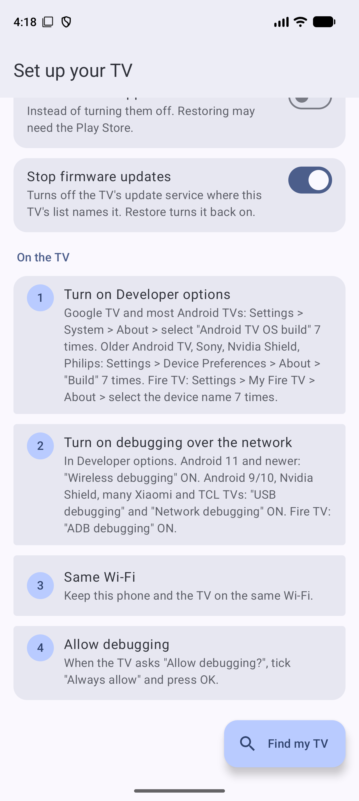
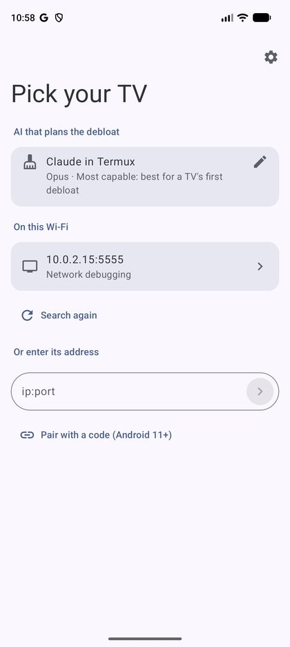
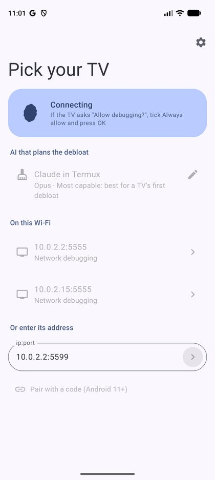
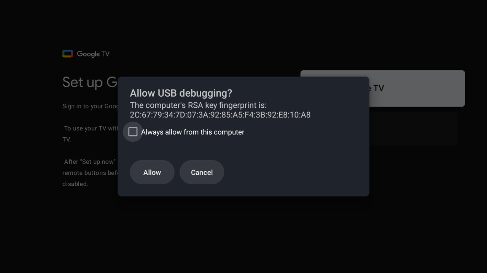

# TVFreedom

TVFreedom is a free Android phone app that cleans up your Android TV. It finds the apps on the TV that
you do not need (ads, tracking, auto-installed apps, pushy updates) and turns them off. You check every
change before it happens, and one tap undoes all of it.

You do not need a computer, root, or any technical skill. You need your phone, your TV, and the same Wi-Fi.

| Set up | Pick your TV | Connecting | On the TV |
|---|---|---|---|
|  |  |  |  |

## What it can improve

- **A faster TV.** Fewer apps run in the background, so menus open faster and the TV has more free memory.
- **Fewer ads and less tracking.** It turns off the maker's ad, promo and data-collection services.
- **No surprise apps.** It stops services that install apps you did not ask for.
- **No unwanted updates.** If you want, it stops firmware updates that can bring back ads or slow the TV down.
- **A cleaner home screen.** It can set up a simpler home screen and screensaver.
- **Nothing breaks.** A safety guard never touches the parts the TV needs (system, Wi-Fi, remote, inputs,
  Cast, voice). It saves a backup first, and **Restore** puts everything back.

## How to install

1. On your phone, download **[TVFreedom.apk](https://github.com/raghavsatyadev/TVFreedom/releases/latest/download/TVFreedom.apk)**
   (from the [Releases page](https://github.com/raghavsatyadev/TVFreedom/releases/latest)) and open it.
   If Android asks, allow your browser or file app to install apps.
2. Open TVFreedom. Tap **Allow local network access**, so the app can find your TV on your Wi-Fi.
3. Pick the AI that suggests what to remove (you can change this later):
   - **Gemini Nano**: runs on your phone. Free. Only on newer phones.
   - **Claude in Termux**: uses your Claude subscription. TVFreedom installs Termux for you and shows
     each step. If Google Play Protect warns you, tap **More details**, then **Install anyway**.
   - **Claude API**: paste an API key.
   - **No AI**: only the built-in safety guard and lists. This works fine for most TVs.

## How to use it

On the TV (one time only):

1. **Turn on Developer options.** Go to Settings > System > About and select **Android TV OS build** 7 times.
   (Older TVs: Settings > Device Preferences > About > **Build**. Fire TV: Settings > My Fire TV > About >
   the device name.)
2. **Turn on network debugging.** In Developer options, turn on **Wireless debugging** (Android 11 and newer)
   or **USB debugging** and **Network debugging** (older TVs). Fire TV: **ADB debugging**.
3. Keep the phone and the TV on the **same Wi-Fi**.

On the phone:

1. Tap **Find my TV** and pick your TV from the list.
2. On the TV, a box asks **Allow debugging?** Tick **Always allow** and press **OK**.
3. TVFreedom makes a plan. Read it, then type **GO** to confirm. It changes nothing before you confirm.
4. Wait while it works. The TV restarts at the end, and TVFreedom checks that everything is fine.

To undo, open TVFreedom, pick the TV and tap **Restore**.

## Good to know

- It works with most Android TV and Google TV sets (Xiaomi, TCL, Sony, Philips, Nvidia Shield) and Fire TV.
- Apps are turned off or removed only for the TV's user. A factory reset brings them all back too.
- When you are done, you can turn off network debugging on the TV.

## For developers

The app lives in `tvfreedom-android/` (Compose Multiplatform, Android target). The design is in
[docs/tvfreedom-android.md](docs/tvfreedom-android.md). Build it with:

```bash
bash scripts/gradle-agent.sh :androidCMP:assembleRelease
```

The PC tool `tvfreedom.py` does the same job over `adb` from a computer.
